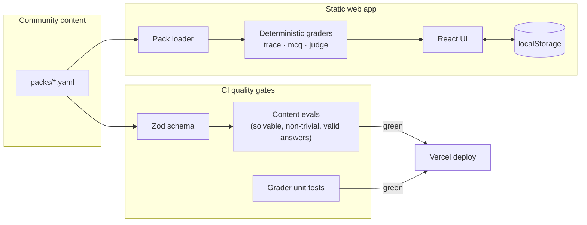

<div align="center">

# 🔎 EvalQuest

### Learn LLM & AI-agent evals by playing, from beginner to SME.

Judge real-looking traces from agents that sell, bank and support. Spot the failure, pick the metric, build a judge, and **prove it agrees with humans**.

**[▶ Play now (free, in your browser)](https://evalquest-livid.vercel.app)** · [Add a scenario pack](CONTRIBUTING.md) · [How it's built](docs/aidlc/01-inception.md)

[](https://github.com/sai337/evalquest/actions/workflows/ci.yml)
[](LICENSE)
[](CONTRIBUTING.md)


</div>

---

## Why this exists

Every team shipping an AI agent eventually asks: **"is it actually working?"** Answering that is a skill, and most of us learn it from blog posts.

EvalQuest makes you **do** it:

- 🔎 **Read agent traces**, not just final answers. Most agent bugs hide in tool calls.
- 🧭 **Choose the right eval** for the job: end-state task success, faithfulness, tool-call accuracy, severity gates.
- ⚖️ **Build a judge and check it against humans.** Most courses skip this skill: a judge with 92% agreement can still miss 70% of the real failures.

No accounts, no API keys, no tracking. Progress stays in your browser.

## Three ways to play

| Mode | You do | You learn |
|---|---|---|
| 🔎 **Trace Detective** | Click the failing step(s) in an agent trace and name the failure | Hallucination, policy breaks, prompt injection, unsafe retries, missed escalations… |
| 🧭 **Eval Call** | Pick the metric, dataset or design that catches the problem | Golden datasets, task success, severity weighting, class imbalance |
| ⚖️ **Judge Builder** | Compose a judge, run it on human-labelled samples, read the confusion matrix | LLM-as-judge design, agreement vs precision/recall, rubric traps |

## The ladder

| Tier | Focus | Status |
|---|---|---|
| 1 · Beginner | Spot failures, learn the words | ✅ live |
| 2 · Practitioner | Rubrics, golden sets, LLM-as-judge | ✅ live |
| 3 · Advanced | Trajectories, multi-turn, RAG faithfulness, self-improving agents | 🛠 next |
| 4 · Pro | Judge calibration (Cohen's κ), drift, CI release gates | 🗺 planned |
| 5 · SME | Boss fights: design the eval strategy for a whole agent platform | 🗺 planned |

## Scenario packs

| Pack | Agent | Example failures |
|---|---|---|
| 🛒 E-commerce | **ShopBot**: orders, refunds, coupons | Refund over the approval limit, invented delivery date, coupon injected through a product review |
| 🏦 Banking | **Penny**: balances, transfers, fraud | Balance leaked to an unverified caller, blind retries of a timed-out transfer |
| 🎧 Contact center | **Nova**: telecom support and rep copilot | Contradicting the outage tool, retention loop instead of escalation |
| ＋ **Yours** | Insurance, healthcare, travel, HR, coding, SRE… | [Add a pack →](CONTRIBUTING.md) |

Each pack is **one YAML file**. No code needed.

## Run locally

```bash
git clone https://github.com/sai337/evalquest && cd evalquest
npm install
npm run dev      # play at http://localhost:5173
npm test         # grader tests + content evals
```

## Add a pack in 4 steps

1. Copy [`packs/_template.yaml`](packs/_template.yaml) to `packs/your-domain.yaml`.
2. Write challenges from failures you've actually seen.
3. Run `npm test`. The content evals tell you exactly what to fix.
4. Open a PR.

## Architecture



**Evals all the way down.** Every pack is checked by automated *content evals* before it can merge. For example, every Judge Builder challenge must be solvable by its reference judge **and** must defeat the "tick every box" judge, so there's always a real trap to learn from.

## How it's built

Built with the **AI-Driven Development Life Cycle (AI-DLC)**, with an approval gate at each phase:

- [Inception](docs/aidlc/01-inception.md): requirements, user stories, design, units of work
- [Construction](docs/aidlc/02-construction.md): test-first engine, content evals, UI smoke tests
- [Operations](docs/aidlc/03-operations.md): deploy, CI gates, improvement loop

## Roadmap

- [x] Engine, 3 packs, Beginner + Practitioner tiers, content evals, CI
- [ ] **Pack Forge**: a self-improving loop. An agent drafts packs, evals grade them, failures become lessons for the next run, and every draft arrives as a PR for human review.
- [ ] Advanced tier: multi-turn, RAG faithfulness, trajectory evals, self-improving agents
- [ ] Pro tier: judge calibration with Cohen's κ, drift, CI release gates
- [ ] SME boss fights
- [ ] Live Mode: bring your own key and run a real LLM judge
- [ ] Export traces as OpenInference to replay in Arize Phoenix and other eval tools
- [ ] 12+ community packs

## Contributing

Packs, bug reports and challenge feedback are all welcome. See [CONTRIBUTING.md](CONTRIBUTING.md).

If EvalQuest taught you something, **⭐ star the repo** so more people find it.

## License

[MIT](LICENSE) © sai337
