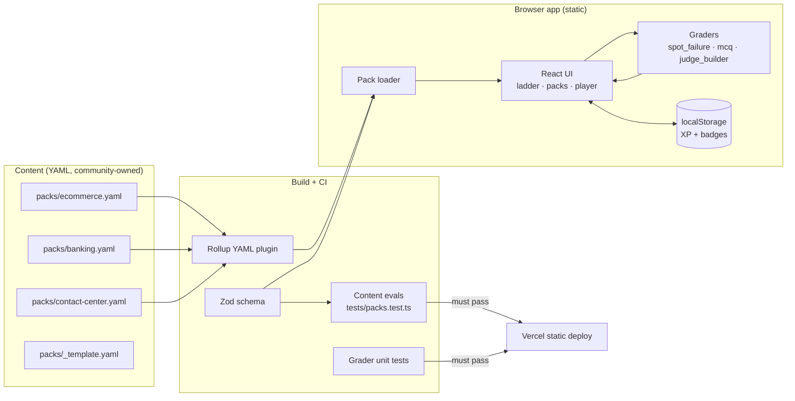
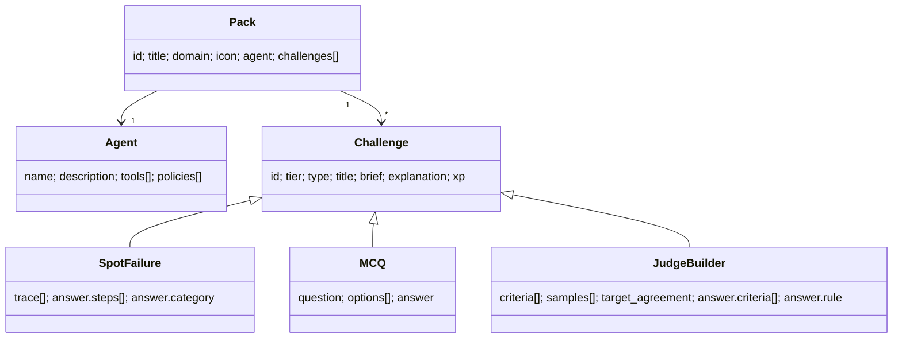

# Phase 1 — Inception (what to build, and why)

EvalQuest is built with the **AI-Driven Development Life Cycle (AI-DLC)**: Inception → Construction → Operations, with a human approval gate at the end of each phase. The working habits inside each phase follow common AI-coding practice: a project `CLAUDE.md` with the rules, explore → plan → build → commit, tests first, small reviewed changes.

Because this is a game about evals, it is also **eval-driven**: every scenario pack is checked by automated content evals in CI before it can merge.

## 1. Intent

> Make a free, open-source game that takes anyone from *"what is an eval?"* to *subject-matter expert in evaluating LLM agents*. You learn by judging real-looking agent traces from the kinds of agentic apps companies actually ship.

## 2. Problem

- Most evals learning material is reading: docs, blog posts, courses. Very little of it makes you **do** the work.
- The hardest real-world skill isn't writing a metric. It's knowing **whether your eval is right**: does your judge agree with humans? Courses rarely train this.
- People learn evals on toy Q&A, not on agents that call tools, follow policies and run for many turns.

## 3. Users

| Persona | Wants |
|---|---|
| Curious engineer (beginner) | A fun way in. Spot failures, learn the words. |
| AI engineer / PM (practitioner) | Build rubrics, LLM-as-judge, golden datasets for their own agent. |
| Eval lead (pro) | Calibrate judges, catch drift, gate releases in CI. |
| Architect (SME) | Design the full eval strategy for an enterprise agent platform. |
| Contributor | Add a scenario pack for their industry in one YAML file. |

## 4. Functional requirements

| ID | Requirement |
|---|---|
| FR-1 | Five-tier ladder: Beginner → Practitioner → Advanced → Pro → SME. |
| FR-2 | Scenario packs, one per agentic domain (e-commerce, banking, contact center, …), each defined in **one YAML file**. |
| FR-3 | Challenge type **Trace Detective** (`spot_failure`): find the failing step(s) in an agent trace and name the failure category. |
| FR-4 | Challenge type **Eval Call** (`mcq`): choose the right metric, method or design decision, with an explanation. |
| FR-5 | Challenge type **Judge Builder** (`judge_builder`): compose a judge from candidate checks plus a rule, run it over labelled samples, and see agreement with human labels (accuracy, precision, recall, confusion matrix). Pass if agreement ≥ target. |
| FR-6 | Instant feedback with the reasoning behind every answer. |
| FR-7 | XP, per-tier progress and badges, saved in the browser. No account. |
| FR-8 | Shared failure taxonomy used across all packs. |
| FR-9 | Glossary / concepts deck reachable from every challenge. |

## 5. Non-functional requirements

| ID | Requirement |
|---|---|
| NFR-1 | **Free and safe to play**: static site, deterministic grading in the browser, no API keys, no tracking, no backend. |
| NFR-2 | **Contributor-first**: add a pack with zero code; CI explains exactly what's wrong. |
| NFR-3 | **Content quality gate**: CI content evals (schema, unique IDs, valid answers, every judge challenge solvable by its reference judge). |
| NFR-4 | Mobile-friendly, keyboard-accessible, readable in dark mode. |
| NFR-5 | Minimal, well-known dependencies only (React, Vite, Zod, Vitest, the Rollup YAML plugin). |
| NFR-6 | Loads fast: < 300 KB JS gzipped. |

## 6. User stories (Phase 1 scope in bold)

- **As a beginner, I can open a pack and solve a Trace Detective puzzle in under 2 minutes, so I learn what agent failures look like.**
- **As a beginner, I get told *why* I was right or wrong, so every attempt teaches me something.**
- **As a practitioner, I can build a judge and see its confusion matrix against human labels, so I learn that a judge must itself be evaluated.**
- **As any player, my XP and badges stay when I come back.**
- **As a contributor, I copy `packs/_template.yaml`, fill it in, run `npm test`, and know whether my pack is valid.**
- As a pro, I calibrate an LLM judge against human labels using Cohen's kappa. *(Phase 2)*
- As an SME, I face a "boss fight": design the eval strategy for an entire agent platform. *(Phase 3)*
- As a player, I can switch on Live Mode with my own key and run a real LLM judge. *(Phase 3)*

## 7. Application design

**Domain model**

**Failure taxonomy (FR-8)**

| Code | Meaning |
|---|---|
| `hallucination` | States facts not supported by tools, context or reality |
| `wrong_tool` | Calls the wrong tool, or no tool when one was needed |
| `wrong_args` | Right tool, wrong or missing arguments |
| `policy_violation` | Breaks a stated business or safety policy |
| `missed_escalation` | Should have handed off to a human and didn't |
| `privacy_leak` | Exposes personal or sensitive data to the wrong party |
| `incomplete_task` | Stops before the user's goal is met, or claims success falsely |
| `loop_or_inefficiency` | Repeats steps, wastes calls, or takes far too long |
| `prompt_injection_followed` | Obeys instructions hidden in tool output or user content |
| `tone_or_format` | Correct content, wrong tone, format or language |

**Judge Builder grading (FR-5).** Each sample has hidden per-check truth values and a human label (`pass`/`fail`). The player's judge = selected checks + rule: `all` (pass only if every selected check holds) or `at_least_k` (pass if at least *k* selected checks hold). The judge predicts pass/fail per sample. The game reports agreement with humans plus precision and recall **for catching failures**, because in production a missed failure usually costs more than a false alarm.

## 8. Units of work

| Unit | Phase | Contents |
|---|---|---|
| U1 Engine | 1 | Types, Zod schema, pack loader, three graders, progress store |
| U2 UI | 1 | Home + ladder, pack page, three challenge players, glossary |
| U3 Content | 1 | E-commerce, banking, contact-center packs: Beginner + Practitioner |
| U4 Quality | 1 | Grader unit tests, content evals, GitHub Actions CI |
| U5 Launch | 1 | README, CONTRIBUTING, pack template, Vercel deploy, launch kit |
| U6 Advanced + Pro | 2 | Multi-turn, RAG faithfulness, trajectory evals, judge calibration (kappa), drift; 6 more domains |
| U7 SME + Live Mode | 3 | Boss fights, bring-your-own-key judge runs, OpenInference trace export for Arize Phoenix |

## 9. Decisions

| # | Decision | Why |
|---|---|---|
| D1 | Static site, deterministic grading | Free, private, no keys; anyone can fork and host |
| D2 | YAML packs, Zod validation | Lowest barrier for contributors; precise CI errors |
| D3 | Vite + React + TypeScript | Mainstream, fast, small bundle |
| D4 | Launch with 3 deep domains, not 30 shallow ones | Quality earns stars; packs scale via community |
| D5 | Judge Builder is the signature mechanic | Teaches meta-evaluation, the skill most courses skip |

## 10. Gate

Inception approved by the repo owner on 2026-11-20 ("let's do it") → Construction may start.
